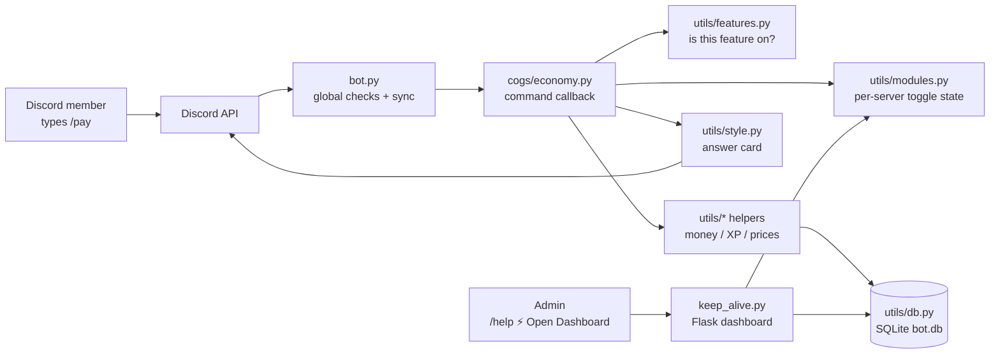

# Architecture — how DaCat Bot fits together 🗺️

A tour for new contributors. Nothing here is new information — it just connects
the files so you know where to look.

## The big picture

Two processes in one: `bot.py` (Discord gateway) and `keep_alive.py` (Flask web
dashboard in a background thread). They share state through `utils/modules.py`
— the **only** reader/writer of on/off toggles — so the dashboard and the bot
can never disagree.

## What happens when someone runs a slash command

1. **Discord** routes `/pay` to the bot process.
2. **`bot.py → global_module_check`** runs first for *every* command:
   - DMs? Only `DM_ALLOWED_COMMANDS` may run outside a server.
   - Always-allowed (`help`, `dashboard`, `sync`, …)? Through.
   - Otherwise look up `MODULE_COMMAND_MAP` (built from `utils/features.py`)
     and refuse with a "turned off, re-enable in the dashboard" card if any
     required feature is off for that server.
3. **Permission checks** run (declared once in `utils/permissions.py`,
   enforced by discord.py decorators or an in-callback guard).
4. **The cog callback** (`cogs/*.py`) does the work, calling `utils/*`
   helpers. Money moves inside `db.run_atomic()` transactions so two
   simultaneous commands can't spend the same coin twice.
5. **The reply** goes out as a card via `utils/style.py` (`send_card`),
   which suppresses accidental pings by default.

## Where things live (and why)

| Question | Answer |
|---|---|
| Which features exist? | `utils/features.py` — one `Feature(...)` each; cogs, dashboard cards, help menu, defaults all derive from it |
| Is feature X on for server Y? | `utils/modules.py` — cached, thread-safe, shared with the dashboard |
| Who may run command Z? | `utils/permissions.py` — `COMMAND_ACCESS` table + picker-visibility stamping |
| Where is data stored? | `utils/db.py` — SQLite (`bot.db`), migrated on boot |
| Where do the tests and the preview write? | *Not* `bot.db`, and this is load-bearing rather than tidy. `tests/__init__.py` points the whole suite at a throwaway file in a temporary directory — `__init__.py` and not `conftest.py`, because CI discovers with `unittest`, which never loads a conftest — and `scripts/preview_dashboard.py` copies `bot.db` aside before it imports `keep_alive`. Both used to write the operator's live database: 3,680 test fixtures (guild `777001`) landed in `scheduled_messages`, and a click on the preview's bulk toggle switched every module off in the Development server, which the bot then uploaded as the production backup. `tests/test_db_isolation.py` fails if either drifts, and it checks the live file's size and mtime, not just the code path |
| How do commands reach Discord? | `bot.py → sync_commands()` on every boot, started as a **background task** (`_publish_commands_in_background`) and never awaited: Discord paces command writes, so a drifted server takes minutes to publish and the boot owes its backup loop, its channel binding and its release note *now* — compare-then-upsert, **per server**, never bulk-overwrite (a rejected bulk sync once wiped a guild to 1 command). A guild's list is that guild's enabled commands — Discord cannot hide a global command in one server, so the list itself is per server, and the shared/global scope keeps only what works with no server to resolve (`help`, `legal`) |
| Which commands does one server have? | `utils/command_scope.py` — pure, one rule read by the publisher, `force_sync.py` and the dashboard panel. Hidden = declared by the feature registry **and** turned off by that server's own modules; a name nobody declares is never hidden. Republished when a module switch flips (`bot.resync_commands`) and on join |
| What does Discord actually hold — and did the republish land? | `utils/command_publish.py` — the other half of the scope panel, and a different claim from *which commands does one server have* (that one is what the server **asked for**). Every publish pass writes its outcome down at one choke point (`bot._sync_scope`, so boot, both drains, the bulk publish and every module switch are covered by construction, plus the two paths that raise and never return a status at all) and the dashboard reads it: whether Discord's copy was **read**, how many commands are **still to write**, when the pass finished, and Discord's own words when something went wrong — four tones the panel draws with the Status panel's own dots. Three rules, each a defect it was written for: **a count that is ambiguous is not printed** (`held` is `None` when a pass was refused part-way through its writes, because a figure under a heading is read as a measurement and an approximate one is worse than none); **the sentence has one author** (`describe()` composes it and the template prints `text`, never assembling it from the numbers, because this box is painted twice — by the server and by the page's own refresh — and two renderers that each spell their own sentence is how the Status panel came to name one environment variable twice; the ok case is **one of three mutually exclusive shapes**, agrees / disagrees / no count to compare, because composed as an opening with the disagreement appended it read "Discord holds 87 commands, matching what this server's switches say. Discord holds 87 — 3 fewer than …"); and **wait for the event, not for a duration** (`/api/toggle` answers with the timestamp of the publish the click supersedes and the panel asks again until that advances — two readings of the server's own clock, never the browser's against the server's, so a host in another region cannot make the wait forever or give up early). A scope nobody has published reads as *not read yet* rather than as agreement, and a page with no server selected asks about **its own** empty scope rather than Discord's shared lane, which holds the DM-safe few |
| Can the bot look different per server? | yes — `utils/identity.py`: Discord keeps `nick`, `avatar`, `banner` and `bio` on the bot's **member** in each guild, so they are per server by construction. `table guild_identity` holds what was asked for; Discord holds what is live. Who may: an administrator of that server via a guild-scoped dashboard link, or the operator's passkey. The application profile stays `/bot avatar` / `/bot banner` (owner only) |
| How does data survive redeploys? | `utils/cloud_sync.py` — restore from Supabase on boot, upload every 25s, final flush on SIGTERM |
| What is the site itself? | one stylesheet and one page, at the project root: `static/meow.css` is the whole design system (tokens, surfaces, buttons, the aurora behind every page, one focus ring, and a `prefers-reduced-motion` block) and every template links it — a page's own CSS, where it has any, comes *after* it so the page keeps winning. `/` is `templates/home.html`, the front door for somebody who is not signed in: real figures from `BOT_INSTANCE`, the feature registry's own list of systems, the invite, and an honest status line that says *Starting up* rather than counting nobody's servers. `/privacy`, `/terms` and `/ai` are `templates/legal.html` rendered from `utils/webdocs.py` — a deliberately small markdown subset (escaped first, `http(s)` links only) over the *same* files the Discord cards read, because Discord's 6000-character budget is a reason to tighten wording, not a reason a policy should be unlinkable |
| Where is the public site published? | **Cloudflare Pages**, built by `scripts/build_site.py` and deployed by `.github/workflows/site.yml` — the bot stays on Render, because a static host cannot answer a request. The build runs in GitHub Actions and only the finished directory is handed over, because Cloudflare's build image has no Python; two repository secrets (`CLOUDFLARE_API_TOKEN`, `CLOUDFLARE_ACCOUNT_ID`) turn the publish on, and without them the job skips with a notice instead of going red. It was written for **GitHub Pages** first and Pages is not available here at all: the repository is private and the owner is on GitHub's free plan, so the API answers `422 Your current plan does not support GitHub Pages for this repository`. Three things the build has to get right, each a failure it already had: every root-relative URL a template emits (`/static/meow.css`, `/pricing`) is rewritten to a relative one, which is what makes the output portable to a host serving from a `/<repo>/` subpath *and* one serving from a root — and a stylesheet's `url()` is rewritten **differently** from a page's link, because `meow.css` already sits inside `static/`, which is precisely the difference that silently cost the cat cursor (`static/static/cursor-*.svg`, a 404 no browser reports, so the only symptom is the system arrow); the build renders through the **real** Flask app's test client rather than a second renderer, so the published copy and the page the bot serves cannot drift into disagreeing about the product; and every page that needs a running process (`/dashboard`, `/login`, `/servers`, the market, `/health`) is rewritten to the live app instead of to a path a static host cannot serve. `_site/` is generated and git-ignored, never committed |
| Where's the dashboard? | `keep_alive.py` + `templates/` — three ways in (Discord sign-in, one-time magic link, passkey), and **seven pages rather than one scroll**: module toggles, message composer, scheduler, per-server command scope, per-server bot identity, status. The rail is those pages, `aria-current` is what the server sets rather than a scroll spy, and `Ctrl`/`⌘`+`K` opens a palette that indexes all of them. The owner's console (`/owner` and three siblings: servers, infrastructure, output) is the other axis — one server at a time *versus* which server is the wrong one |
| Does the bot do anything nobody asked for? | nothing any more. There used to be exactly one thing, and it was opt-out: the voice companion — `utils/company.py` + `cogs/company.py`, which joined a channel whose only occupant was one person, greeted them and left — was **archived on 2026-10-06** with the rest of that pass (see the archived-systems section below). What is still true of voice belongs to other rows: **a bot cannot watch a Go Live stream** — Discord has no API for it and the gateway carries no video — so the owner's Live page reports the fact per person (`self_stream`) beside who is alone right now, and never pretends to show a picture |
| Why does the Live page show no "who is online" figures? | because this deployment does not ask for Discord's **Presence intent** — and the page says so rather than printing numbers. Without it Discord does not leave `Member.status` off the object, it answers **offline for every member**, so the first version of that card printed *1 online, 35 offline* for a server with people in it: the one online was the bot, whose presence its own process sets. The guard is therefore the *intent* (`bot.intents.presences` **and** `members`, since presences only arrive for the members a client tracks), the payload's `read.presence` goes false, and the page draws the dash and the switch to flip: Presence Intent in the Developer Portal, then `ENABLE_PRESENCE_INTENT=1`. Voice rosters, who is alone and who is streaming are unaffected — those come from voice states, which need no privileged intent. `bot.portal_intents`/`drop_ungranted_intents` are what keeps the flag safe: asking for a privileged intent the portal has not granted makes Discord refuse the whole connection, so an un-granted one is dropped with its name printed instead of taking the bot offline |
| What happens after the bot's own moderation acts? | `utils/modlog.py` is the one door every writer goes through — a moderator's `/warn`, `/ban`, `/mute`, the bot's *automatic* actions, and the member's appeal — so the record is one list rather than three that each look complete. `/automod` deletes an invite and times out a flood on its own, and each decision now posts a card naming the rule that fired, the member, the channel and **whether Discord accepted the action** (a refused `timeout` reads as *not muted*, with how to fix it, because the filter otherwise looks as if it worked); no message content is copied in, since the rules fire on a count and a pattern and a log is not the place to keep a second copy of somebody's text. `/appeal` is the member's half: any member, one per five minutes, filed as a real `Appeal` case with their own words and their last three cases attached, answered with the sentence that nothing reverses automatically — a moderator answers it with `/unmute` or `/unban`, which are logged like every other action. With no log channel set it reaches the server owner by DM instead, and with nowhere to send it the member is told nothing was recorded rather than being left to guess |
| What decides how the web surfaces look? | two sheets and a test. `static/meow.css` is every public page (the dashboard, the hub, the landing page, the two policies and every sign-in form) and `console/src/styles.css` is the operator's console, and each is written to the same five laws: **60-30-10** (one background, one raised surface, one accent spent on what can be acted on), **a scale rather than a pile of one-offs** (body text 16–18px, every size from a `--type-*` token), **one accent** (three state colours may only report a state), **nothing reachable only with a mouse** (one `:focus-visible` ring per sheet, 44×44 for anything a finger hits, an `outline: none` only where the same rule draws a replacement) and **chunked navigation** (nine console pages grouped into three, never one list of nine). `tests/test_design_laws.py` is what makes those sentences true rather than aspirational: it computes WCAG contrast from the palette tokens in every theme, measures the body size, reads the headings, the `alt` attributes, the outline rules and the target floors out of the stylesheets, walks the registry for the nav arithmetic, and fails if a console rule writes a colour literal of its own. The rules the reference documents add on top of those five are checks too: a **12px floor** under every `font-size` in all three sheets and every template (with `rem` resolved against the root the sheets actually set, and a docstring saying why `em` and `%` are deliberately not guessed at), a **75-character ceiling** on any `max-width` in `ch` — and a failure for a sheet that declares no measure at all, because *no measure* is the case the number cannot catch — a **name on every field** in the templates and the JSX (a placeholder is not a label: it vanishes the moment somebody types), and **reduced motion** in two halves, the media query in each sheet and the `MotionConfig reducedMotion="user"` the console hands its animation library, because a media query cannot reach a JS spring |
| How many servers and people does the bot actually reach? | `utils/figures.py` — the one module that turns this deployment's own counters into a page a **stranger** reads, which is why it is four rules and not a query. **Counts, never names** (a landing page may say *1,669 people reached*; it may not say which twelve — the per-channel and per-member breakdowns stay behind the dashboard's sign-in); **a reading that was never taken is absent, not zero** (a sleeping free-tier host has no gateway to ask, and a confident *0 servers* reads as a bot nobody uses); **nothing is fetched while a request is being answered** (two indexed local reads, cached for a minute, so a refresh loop costs one query rather than one per visitor); and **the windows belong to the tracker** (`today`/`week`/`month`/`all` are `utils/digest`'s own, with `tests/test_figures.py` comparing the arithmetic so the two cannot drift). Served live by `/api/figures` — which carries a cross-origin allowance for the site's own address, because the published copy is a file on a CDN asking a browser-side question and a refused `fetch` reaches no banner — and rendered server-side into both the landing page's figures cards and the console's *What the bot is doing* panel |
| Who may open the dashboard for a server? | whichever way in the session used. A **Discord sign-in** (`utils/discord_auth.py`) asks for `identify`+`guilds`, keeps the servers where the person holds Manage Server/Administrator/owners *and* the bot is in, and the session may reach only those (`_resolve_guild_id`, scope `user`); a **one-time link** from `/help` is scoped to the server it was minted in; the **passkey** is the operator's and reaches every server. `/servers` is the picker for a Discord session, and every server-scoped route re-checks the list on each request, so a server the bot has left or the person was demoted from stops being reachable immediately |
| What is a server entitled to, and who paid for it? | `utils/plans.py` — the plan model (what each tier includes, how many servers and how many scheduled messages) plus the Lemon Squeezy licence that proves it. A licence is activated **per server** with `/bot plan`, and Lemon Squeezy counts activations against the limit on the licence, so "up to 5 servers" is the store's rule rather than a number this bot invents. Validation is the store's **public** licence API, so no API key is stored anywhere and no webhook endpoint has to exist; a key for a product this deployment does not sell is handed straight back, and a network failure never downgrades a server. **Selling ships off** (`PLAN_CHECKOUT`) and **enforcement ships off** (`PLAN_ENFORCEMENT`), both read fresh every time, and they are separate switches on purpose: filling in a checkout link while a store is being set up is configuration, not a decision to charge. The selling switch is checked in exactly one place — `plans.checkout_url`, which every surface that offers a plan for money already goes through — so no page has to remember to ask. While selling is off there is **no premium surface at all** — no tiers, no prices, no Buy buttons — and `/pricing` is a free product's page: one plan, every system from `utils/features.py`, the price from this model, and a note that paid plans may come later. The page used to keep describing the tiers with only the buttons switched off, which advertises a shop that is not open; the whole surface now appears and disappears together with the switch (`keep_alive.pricing_page` passes `selling` and the template branches on it once). While enforcement is off every server keeps every system, and the pricing page says so in words. When it is on, the withholding is applied in exactly one place — `utils/modules.get_states`, which the command gate, the per-server command list and the dashboard all read — so a switch, a picker and a refusal cannot disagree about the same server. `tests/test_plans.py` pins both states, and the prices on `/pricing` come from this same model so the site cannot advertise a tier the code lacks |
| How do you add the bot to another server? | `discord_auth.invite_url()` — the Discord authorize URL with `bot`+`applications.commands`, offered in the dashboard header and on `/servers` (with `guild_id`+`disable_guild_select` when a specific server is meant). **Two grants, always offered together**: the default asks for `Administrator` (one bit, so no feature can ever arrive as `Missing Permissions`), and `invite_url(minimal=True)` builds the least-privilege link from `MINIMAL_PERMISSION_BITS`, each entry naming the call site that needs it. `keep_alive._invite_context()` builds both — or neither, when no client id is set — so a page cannot offer one without the other |
| Who may read this — and who may not train on it? | `utils/ai_guard.py`, in three layers, because each exists for a way the one before it is ignored. **The directive**: one function builds `robots.txt` (each AI crawler named with `Disallow: /` *before* the wildcard, because a rule written after `User-agent: *` is read by nobody) and `ai.txt` (the training prohibition in the convention crawlers look for); the app serves both at `/robots.txt`, `/ai.txt` and `/.well-known/ai.txt`, and all three static builds write the *same functions'* output, which is what stops four hosts from answering one question four ways — two of them published `Allow: /` and nothing else before this. **The reservation in headers**: `Content-Usage: train-ai=n`, `tdm-reservation: 1`, `tdm-policy` and `X-Robots-Tag: noai, noimageai` (plus `noindex, nofollow` behind a sign-in) on every response, because a header reaches an API answer and an error page as readily as it reaches HTML. **The refusal and the trap**: a declared AI crawler is answered 403 with the addresses of the documents it is ignoring, and two paths no page links a person to — disallowed in the directive, absent from the sitemap, off-screen and `tabindex="-1"` in every public footer — answer with a decoy that says what it is and record the fetch (agent, address, country, count; folded so four hundred requests are one row) in `net_guard_events` for 180 days. A trap fetch is the only signal here that identifies a collector *positively* rather than guessing from behaviour, so it goes to the operator as a card with what to do about it; `tests/test_ai_guard.py` holds every claim, including the negative ones — a browser, a monitor, `curl` and a reader with no `User-Agent` are all still served. The policy is `AI_POLICY.md`, the clause is Terms §14, and the operator's playbook (including the WAF rules) is `docs/anti-ai.md` |
| What did a signed-in person agree to, and to which revision of it? | `utils/consent.py` plus `/agree`. The Terms were browsewrap — a footer link and a sentence about continued use — and a crawler cannot assent to a hidden link, so the prohibition it never saw was never a term. The door (passkey, one-time link, Discord callback, the owner form) now wraps its destination in `/agree`, which lists the three documents, shows the **revision** (the SHA-256 prefix of the files themselves, so a sentence added in September is not covered by an agreement made in June) and offers two answers of exactly the same size. Accepting writes one row — revision, scope, address, browser, time — and marks the session; declining signs the session out, changes nothing and records nothing; a ledger that cannot be written still lets the person in and *says so*, because a clickwrap that silently stops recording is worse than none. The policies themselves are never behind it: a policy you must accept before you may read is not a policy |
| Where do dashboard messages go? | `utils/scheduled.py` — one row per message, whether it is still queued or was posted the moment it was written (`source`) — plus `keep_alive.py` (the delivery tick, started from `bot.py`) |
| How does an update get shipped? | `/bot push` (`cogs/bot_config.py`) — with a Render Deploy Hook in `RENDER_DEPLOY_HOOK_URL`, `utils/deploy.py` POSTs it and the boot announces the release itself; with no hook the command says no code moved and posts this version's notes through `bot.announce_release_notes_to_guild`. The bot cannot commit: it can only deploy what is already on GitHub. Its card goes to the server's `test` channel, falling back to `update` |
| Where does the bot post in *this* server? | `utils/bot_channels.py` — `update` / `error` / `bug` / `commands` / `log` / `test` are per-guild settings, bound by channel *name* the first time a server is seen (`#update`, `#bot-error`, `#bug-report`, `#bot-cmd`, `#logs`, `#test-ground`) and authoritative after that — matched exactly first, then with decoration stripped, so `💬・bot-cmd` binds the same role. The release note's ping resolves the same way: the role id the bot has always pinged where that server has it, otherwise a role named `Dev` / `Admin` / …, otherwise nothing. A hardcoded channel id here is a bug: it names exactly one server, which is why the update channel, the failure channel, level-up cards and bug reports were all invisible everywhere else. A **bug report** is the one message allowed to leave the server it was filed in: it is posted in that server's own bug channel, and in the bot's own server (`BOT_SERVER_GUILD_ID`, whose `#bug` is found by name even before anything has been bound) when this server has none — so a report can never be refused for want of a channel, and it is never a ticket, which is the ticket panel's job for members' own problems. Two roles, `guilds` and `cmdlog`, belong to **the bot's own server only** (`roles_for` refuses them everywhere else, so no member server can bind them even by naming a channel to match): `#active-servers` and `#real-time-cmd-data` are the operator's log of who has the bot and what people run with it — see the row below |
| What does the operator learn about the bot itself? | `utils/operator_log.py`, fed by four events in `bot.py`: `on_guild_join` (a server added the bot — logged with its size, owner and, when View Audit Log allows, who added it; the same handler also binds its channels and sends it the release note, each step isolated so one failure cannot hide the others), `on_guild_remove` (removed, deleted, or banned — all one event), `on_app_command_completion` (every command, with the runner, the server, the channel and the moment), and `tree.on_error` (`command_failed` — the command, the runner, where it ran and the reason, which is the entry the operator needs most and the one completion can never produce, because discord.py dispatches completion only in the `else` branch of its own call: a command that raised never reaches it, so a broken bot used to leave an empty channel that read as "nobody uses this"). Three rules, each a failure this project already had: an entry may never break the thing it logs (every failure is reported on the host and swallowed), an entry may never ping (a card carries `NO_PINGS`, which matters because a server's *name* is a stranger's text and `@everyone` is a legal server name), and what a person **typed** is never copied into the log — the command, its runner and its outcome are the record, not its arguments. `bot_server_guild_id()` falling back on a malformed `BOT_SERVER_GUILD_ID` is what keeps a typo in an environment variable from costing the entry. A failure's *reason* is carried only when it comes from Discord (a transport fact); a Python-level error is recorded by its type alone, because a message raised while handling what somebody typed can quote it back and the log promises never to copy that. `report_second_instance` is the fourth rule's opposite number: a boot that finds another live copy of the bot — the same database lease that stops two copies fighting over the backup, `cloud_sync.other_copy_verdict`, read for the gateway hazard (twice, because a claim outlives the process that wrote it, and the line it prints says which answer it got either way) — posts one card naming it, because two sessions of one application receive every interaction, one answers, and the loser's command ends in *Interaction has already been acknowledged* while the ones that reach a quiet session are answered too late to count. `announce_setup` posts the one-time card that explains both channels, on the boot that binds them and never again (it is posted from what that boot *wrote*, not from a read-back of the store, so a write that has not landed cannot cost the card that exists to explain the channel), and `_notice_missing` reports the first entry that finds nothing bound — into the update, then error, then log channel, once per role per process, because an installed feature that writes nowhere is otherwise indistinguishable from one that works. **The events that cannot be posted at all go out of band**: `utils/alert_webhook.py` posts a silent, bounded message to a second webhook for the three situations a channel inside a server cannot serve — a server that has *just* added the bot is in none of that server's channels, a down gateway is why the web process is answering, and a request flood arrives at the web surface, which has no gateway to begin with. Silent (`SUPPRESS_NOTIFICATIONS`) so the channel can be watched without paging anybody, one message per kind per 30 seconds and 120 per process so the thing watching a flood is not the amplifier, from a daemon thread so a wedged receiver cannot hold a page open, and unset-by-default with the dashboard's Status panel reporting that as a missing setting rather than as a quiet success — which is the failure this project keeps being caught by. Its field list is the *same* list `PRIVACY.md` §5 and `TERMS.md` §12 publish (event kind, address and client string, path, coarse country, counts, a server's name and id), asserted as an exact key set in `tests/test_alert_webhook.py`, so an entry that grows a new key fails the suite rather than shipping a silent policy change |
| What happened to `/radio`, `/qna`, `/starboard`, `/structure` and `/company`? | all five were **archived on 2026-10-06** — the files, their tests and their templates are in `deleted_features/`, the registry declares none of their commands, and `deleted_features/README.md` is the restore recipe. Nothing live imports them, and nothing in the tree answers to those names any more: the naming left the registry, so `/help`, the pickers, the dashboard and the site followed from that one edit, while `utils/commands_sync.RETIRED_COMMANDS` is what removes the **stale registrations** from Discord's picker on the next publish. What survives deliberately: the tables they wrote (`qna_questions`, `starboard_*`, the `radio_*` preferences) and the doc that reaches them (`docs/legal/data-requests.md`). The archived-systems section below holds the longer story, including the one thing radio taught that is still enforced — `utils/voice_caps.py` probing a host **before** anything joins a channel, still read by the boot line and `/api/voice-debug` |
| Why is a command missing from the picker — or still in it after being removed? | `utils/commands_sync.py` compares, `bot.py` publishes, `force_sync.py` does the same job from a terminal. Three rules, each already paid for: **read → compare → write**, because Discord allows 200 command writes a day per scope and a blind re-upload spends them on nothing; **upsert one command at a time, never a bulk overwrite**, because a rejected bulk sync has already deleted the scope's whole list (this bot was once left with a single command); and **a name leaves the picker only by being on `RETIRED_COMMANDS`**, because the publisher can only add or replace — a folded command has no local counterpart, so it is neither missing nor stale and nothing else would ever remove it. That list is load-bearing: Discord allows **100 chat-input commands per scope**, and twelve folded names (`/dashboard`, `/sync`, `/updatedb`, `/setavatar`, `/setbanner`, `/addlevelrole`, `/removelevelrole`, `/privacy`, `/tos`, `/meowfee`, `/activity-top`, `/activity-channel`) held the last of that budget, so creating `/bot` and `/legal` was answered with ``30032 Maximum number of application commands reached``. A refusal of one command must not stop the ones behind it — the scope is only full for a *new* name, and updates are still allowed — but a spent daily budget must stop everything, because that window is closed for all of them. Whichever it is, the boot prints the reason: a scope that published nothing used to say only *"published 0, 32 still pending"*, which is how a picker missing two commands and offering twelve dead ones stayed that way for weeks. The `/bot push` command and every deploy go through this same path. |

## The dashboard's pages

Neither console is one document any more. `DASHBOARD_PAGES` (nine) and
`OWNER_PAGES` (nine) are the single list each rail renders from, every route
resolves to one page id, and each page renders only its own section — so the
composer's listeners only register where a composer exists and the scheduler's
poll only starts where a queue does. Both rails are also **chunked**: the groups
come from the server (`DASHBOARD_GROUPS`, `OWNER_GROUPS`) for the same reason the
pages do, a page nobody placed renders ungrouped rather than vanishing, and
the home page is deliberately in no group — a home link under a heading reads as
though it belongs to that heading. Two consequences worth knowing before
editing either template:

* **The script is one file per console, guarded at each element.** A page is a
  set of sections behind ``; the script below them is shared,
  so a listener registered on a null element would take the rest of the script
  with it. That is why the composer, the scheduler and the bulk switches each sit
  behind a `const …Here = Boolean(...)`.
* **A control that lives on another page is reached by hash.** The palette's
  actions name the page they need, and a cross-page one navigates to
  `/dashboard/systems#btn-enable-all`; the destination page's shell focuses the
  element it names on load. A link to a page is not a link to a control.

The pages, and what each owns:

| Page | Owns |
| --- | --- |
| `/dashboard` | ping, systems on, members, commands offered — the one-screen answer |
| `/dashboard/systems` | every switch the registry declares, the filter, the bulk toggles |
| `/dashboard/composer` | the message builder, channel picker, tag search, receipt |
| `/dashboard/schedule` | the queue, the history, cancel and send-now |
| `/dashboard/identity` | per-server nick, avatar, banner, bio |
| `/dashboard/members` | the roster, the ban list, and one action form — warn, time out, kick, ban, unban |
| `/dashboard/server` | lockdown, lift, and slowmode applied to every channel at once, beside `/hidden`'s reading of this server — the rooms off every list right now and the ranks that can still see them |
| `/dashboard/commands` | the per-server command scope and whether the republish landed |
| `/dashboard/status` | monitors, command publish, this deployment's own readings |

And the jobs themselves:

1. **Module toggles** (`/api/toggle`) — persist via `utils/modules.py`, then
   schedule an immediate cloud backup so a restart can't undo the click.
2. **Message composer** (`/api/send-message`) — posts as the bot, max 5
   channels, every mention re-resolved against the live guild (a browser can
   send anything, so nothing it says is trusted).
3. **Scheduled messages** (`/api/schedule-message`) — the same builder as
   "send now", stored instead of posted, and delivered from a tick on the bot's
   own loop. Claiming a due message is one conditional `UPDATE`, so a message is
   posted exactly once no matter how many things look at it at the same moment.
   An immediate send is written to the same table as a finished row
   (`utils.scheduled.record_sent`), which is the only record it leaves: the
   receipt lives in the page, and "which channels got that announcement?" has to
   outlive it. Only `pending` rows are ever delivered, so a record can never be
   posted twice. A delivery that did **not** arrive — refused, partly refused,
   skipped for being too late, or interrupted by a restart — is posted as a card
   in the guild's `log_channel_id`, tagging whoever queued it
   (`keep_alive._alert_schedule_outcome`); with no usable log channel that person
   is DM'd instead. A message that went out is not news: it is visible in the
   channel it landed in.
4. **Live market pages** (`/market/<SYMBOL>`) — public JSON + canvas chart
   fed by the same price snapshot the commands trade on.
5. **The public pages** (`/`, `/privacy`, `/terms`) — no session, no gateway
   dependency for the two policies, and every figure on the landing page either
   measured or absent.
6. **Member actions** (`/api/member-action`, `/api/member-warnings`) and
   **whole-server actions** (`/api/server-action`) — the two pages above, and they
   are thin on purpose: the guard, the hierarchy and the action itself live in
   `utils/moderation_actions.py` (the module `/kick` calls) and
   `utils/server_control.py`, so a kick from a phone and a kick from a webpage
   take one code path to one audit row. Three rules hold the surface together.
   **The authority is the session's, re-checked per request** — `utils/principal`,
   the same rule the toggles already ask — and the *person's own* Discord
   permissions decide what may be done to whom, which is the guard the slash
   commands have always used. **A refusal is an answer**: permission problems, a
   member who left between the page loading and the click, and a server the bot
   is not in are all a sentence naming what to do rather than a 500. **Every
   action is one row in `web_actions`**, because Discord's audit log credits the
   *bot* (the bot is what performed it) and this is the only place the person who
   asked is written down. A lockdown writes its ledger **before** it touches a
   channel: a bulk permission change that failed to record itself would have no
   undo, and the undo is the whole reason a lockdown is allowed to be one click.
   **That same ledger is what enforces the lock** — Discord's `Administrator`
   permission and a guild owner bypass channel overwrites by design, so a locked
   channel is held by the deny *and* by an `on_message` listener that removes
   anything a person posts into it (the bot's own card excepted); the row leaves
   when the unlock restores what was there, and the removals stop with it.
   **A channel locked before that ledger existed is adopted at boot**: the
   overwrite has the shape the lockdown commands write and Discord's audit log
   says this bot was the last to change `@everyone` for it, so the missing row is
   written — with no previous overwrite, because the old command never recorded
   one, which makes `/unlock` *remove the deny* rather than pretend to restore a
   room nobody wrote down. Adoption never changes a permission, and a log that
   cannot be read adopts nothing. **A row also records who the lock holds**, not
   only how to undo it: `/lockdown` with `scope:server` is the one lock that leaves
   administrators and the owner talking — a permission cannot stop them anyway,
   and a whole server nobody can coordinate through is a lockdown the staff
   cannot run — while `/lockdown` holds one room for everyone, and rows written
   before that column existed read as the strict lock. **And a deny has to reach
   the overwrites somebody was let in through**: Discord applies a role's and a
   member's overwrite *after* `@everyone`'s, so an allow there beats the deny, and
   the lock therefore writes its deny on every overwrite that grants one — merging
   `@everyone`'s rather than replacing it, because a replacement overwrite says
   nothing about the bits it does not mention and a lockdown once deleted a
   private channel's `View Channel=False` that way, handing the room back to the
   whole server. The row records each of those overwrites, so `/unlock` puts a
   role's allow back as well as `@everyone`'s, and the bot's own overwrite is
   never a target — the card it posts into the room it just locked needs the
   allow it already had. `/lockdown hide:True` is that same lock with
   `View Channel` denied on the way past (the *private* room rather than the quiet
   one), sparing only the sight of whoever asked and of any role that can manage
   channels, because a hidden channel its own moderators cannot see is a channel
   nobody can open again.
7. **The operator's own controls** (`/api/console/server-action`) — republish a
   server's command list, leave it, leave *and block* it, or take it off the
   blocklist. Operator scope only (`_require_operator_api`), so a server's own
   administrator can hold every switch in the Systems panel and still not be
   allowed to make the bot leave. The blocklist is enforced **on the way in**
   (`bot.on_guild_join` refuses and leaves before any setup work), because a list
   a re-invite can walk around is a note to self rather than a rule. `/owner/god`
   is that same scope behind a second, time-limited one (re-proved with the owner
   passkey, `GOD_UNLOCK_SECONDS`): pause/resume, the two fleet switches, and the
   **fleet announcement** — one message to every server the bot is in, written as
   a template whose four tokens (`{server}`, `{members}`, `{systems}`, `{bot}`)
   are the only ones it will send. It is previewed first and the preview is a
   **GET**, because it is a *reading* of the fleet: each server's bound `#update`
   channel, else Discord's system channel for that guild, else the reason that
   server cannot be reached. The send is the CSRF-checked POST of the same pass
   (`utils/broadcast.py`), and a ping is a single role with a hand-built
   `AllowedMentions` — the message carries a server's own name, and a server may
   be called `@everyone`.

## The message layer (`utils/style.py`)

Every non-interactive message is a Components V2 card, and V2 is stricter than an
embed in three ways that have each been a shipped bug:

- **An attachment is invisible unless a component references it.** Discord's
  component reference says it in one line: *"Attachments won't show by default -
  they must be exposed through components"*. The upload succeeds, the API accepts
  the message, and nothing is drawn — which is why `/meowsound` had "no sound"
  while looking fine. `send_card(file=…)`/`files=…` now appends a File component
  for each upload, and skips the card entirely (legacy send) if the installed
  library has no File component, where an attachment is at least visible as a file.
  **That command is no longer a card, though, and the reason is the same one from
  the other side**: a File component draws an attachment as a row with a download
  arrow, so `/meowsound` posts one plain message instead and lets the *client*
  draw the audio — see `style.send_plain` below. A card is still the right shape
  for everything that is not audio.
- **Mentions notify, so they must be opted into.** A `TextDisplay` mention pings
  its target; `send_card` therefore defaults to `AllowedMentions.none()`, and a
  card that is *about* somebody passes `style.pings(target)`. Without that, a card
  can name two people and reach neither — which is what `/action`, `/rizz` and
  `/roast` did. `pings()` names `everyone` and `roles` as `False` because
  discord.py treats an omitted field as *allowed*.
- **A picture has to exist.** Cards resolve GIFs through `utils/gifs`, which
  fetches from keyless providers and only uses a URL after a probe confirms an
  `image/*` body; nothing confirmed means no picture, never a broken one.

A bot's presence has one more rule of the same kind: the word in front of the
status ("Playing …") is Discord's, chosen by the activity *type*. A line written
as a headline renders as "Playing Meowing at the wall", so shipped lines read as
continuations, and `custom` exists for a line with no verb at all.

### The card's type and spacing scale

Discord draws four sizes and one hairline, and a card assembled without a rule
puts a title, five bold labels and a footer at the same volume. So `utils/style`
owns the scale and the builders are the only place a marker is written:

- **`title()`** is the subject — the only level-two heading on a card, so a body
  that opens with its own `##` is demoted to a group rather than arguing with the
  title. **`section()`** is a group inside a card; body text is unmarked; and
  **`label()`** (Discord's small `-#`) is what a value *is*. A field is therefore a
  quiet label over body text: read down to find the field, across to get it.
- **Spacing is four named levels** — `GAP`, `BREAK`, `RULE`, `RULE_LARGE` — placed
  by `_place()`, which holds three invariants: never a spacer as a card's first or
  last child, never two spacers side by side (the stronger one wins), never a rule
  where it separates nothing. `clean_text()` trims every string, collapses runs of
  blank lines, and drops a hand-drawn divider that would otherwise sit directly
  above the card's own rule.
- **One accent, four states.** `ACCENT` plus `SUCCESS`/`WARN`/`DANGER`/`INFO`, and
  `accent_for()` is the only door: a value `ACCENT_ALIASES` knows becomes the state
  it means, anything else becomes the accent. That is what the 251 `0x` literals in
  the cogs meet on the way in.
- **New content has one place to go**: `Panel.append()`, which inserts above the
  closing rule, so a merged embed's later fields or a route's extra line cannot
  land *under* the footer's hairline.

`scripts/preview_cards.py` renders the cards without sending one: it builds the
fixtures through the real module, reads them back out of `to_components()` — the
JSON Discord receives — and draws two columns, the working tree and any revision
of `utils/style.py` loaded out of git, with the component/spacer/accent counts
beside each. It exists because a card can otherwise only be seen in Discord, and a
preview drawn from a hand-written mock would agree with whatever its author
believed.

### The media watch (`utils/media_health.py`)

"A picture has to exist" is checked at use time, which leaves the other half open:
a hand-typed link in the tree can rot for as long as nobody looks at that card, and
a dead link is the quietest failure in the product — Discord accepts the message,
draws an empty box and reports nothing anywhere.

`keep_alive.start_media_health` runs one pass on the bot's own loop, on a clock kept
in the database (`MEDIA_CHECK_INTERVAL_HOURS`, a week by default) rather than in the
process, because Render restarts this bot often enough that an in-memory timer would
mean a sweep of every URL on every deploy — and a check that costs something on
every boot is a check that gets switched off. A pass probes two kinds of target:

- **hardcoded** media, *found* by scanning the files that may hold one rather than
  listed by hand, skipping tests, docs and retired cogs (a deliberately broken URL
  in a test is not a fault to report);
- **resolved** media — one target per action and per pet, read off `utils/gifs`'s own
tables, so an action added there is covered without anybody remembering this module.

Three rules, all of which were learned from the failure this was built for: a `200`
is not evidence (a body whose content type is not media is reported as *not media*),
**a clean week is silence** (a weekly "everything is fine" is how a channel gets
muted), and a pass **never raises** — a target that could not be asked lands in
`unchecked`, kept apart from `dead`, because "this link is broken" and "I could not
reach anybody" are different sentences and only the first one sends somebody to edit
a URL. Findings go to the operator channel via `operator_log.media_alert`, naming the
target, the file and line, and what the probe got; counts (never names) are on
`/health` as its own `media` block; `scripts/check_media.py` runs the same pass by
hand and exits non-zero on a dead link.

Two of those targets were once three: a **stream probe** opened a known station all the
way to a first byte, because a station can answer its own URL while the deployment has
no route out. That target went with the radio on 2026-10-06 — nothing live plays audio
any more, so a probe of a station would be a check on a feature the bot does not have —
and `utils/voice_caps.py` stayed, because what it answers (*can this host do voice at
all*) is still read by the boot line and `/api/voice-debug`.

### The radio, the inbox, the starboard, Server Structure and the companion — archived (2026-10-06)

Five systems were retired in one pass, at the operator's word, and they are archived
rather than deleted: `deleted_features/` holds the files, their tests and their
templates, and its `README.md` is the restore recipe. What each one was, in one
sentence, because the reasoning is worth keeping even where the feature is not:

- **Radio** (`utils/radio_catalogue.py`, `utils/radio.py`, `utils/radio_stream.py`,
  `cogs/radio.py`) — one group, `/radio play|stop|doctor`, playing a verified broadcast
  station into a voice channel. Its shape was four files and one job each: the table is
  data, the policy is pure, the engine owns the socket, the cog is the surface. The
  thing it replaced — `/play`, which resolved a named song through `yt-dlp`, a ladder of
  player clients and three providers — stays archived separately in
  `deleted_features/radio_2026_09/`, with its own `yt-dlp` requirement.
- **Anonymous Q&A** (`utils/qna.py`, `cogs/qna.py`) — a question posted by webhook with
  nobody's name on it, the asker visible only to the operator, the answer DMed back.
- **Starboard** (`cogs/starboard.py`) and **Server Structure** (`utils/structure.py`,
  `utils/confirmations.py`, `cogs/structure.py`) — the pin-what-people-star feature and
  the confirmed channel/role management tier.
- **The companion** (`utils/company.py`, `cogs/company.py`) — the one thing the bot did
  that nobody asked for: joining a voice channel whose only occupant was one person.

**What the removal had to get right, and each was a failure mode rather than a chore.**
The registry is the source of every surface, so the four `Feature(...)` blocks went and
`cogs/help.py`, `utils/permissions.py`, the dashboard and the site followed from that
rather than from five hand edits each. The **picker is a different machine from the
tree**: a command that leaves the tree leaves a live registration behind, which is why
`utils/commands_sync.RETIRED_COMMANDS` names all five roots and the next publish is what
clears them. **Tables outlive commands**, so `qna_questions`, `starboard_*` and the
`radio_*` preferences are deliberately left in the database with
`docs/legal/data-requests.md` still reaching them, because a member's deletion request
does not stop mattering when a command does. And the laws that were about the *tree*
rather than about a feature were **re-created rather than archived**: what is now
`tests/test_direct_writes.py` is the half of the old `test_guardrails.py` that pinned
every direct write in `cogs/`, and it outlived the management tier it was written
beside.

The console and the site followed the same rule one level up: `Questions.tsx` is gone,
the Live page's Radio panel and the dashboard's radio card are gone, and
`utils/media_health` probes two kinds of target instead of three. The media watch's own
rule — *a clean week is silence* — is why nothing announces an absence, and the retired
features' public edges (`/radio`, `/owner/questions`, `/api/console/questions`) are
removed from the routes, the tests and the nav rather than left answering 404.

## Conventions that keep 600+ tests green

- **Declare, don't duplicate.** Feature? → `features.py`. Audience? →
  `permissions.py`. The tests diff the registry against the real command tree
  and fail on drift.
- **Transactions for money.** Any function that moves coins uses
  `db.run_atomic()` with conditional writes (`UPDATE … WHERE balance >= …`).
- **Pure helpers where possible.** `utils/rewards.py`, `utils/levels.py`,
  `utils/meowfee.py` take plain arguments (no `discord` import) so tests can
  call them directly.
- **Cards never ping by accident.** `send_card` defaults to
  `AllowedMentions.none()`; only `/announce` and the cards that are *about* a
  person (`/action`, `/rizz`, `/roast`) opt in, deliberately and by name.
