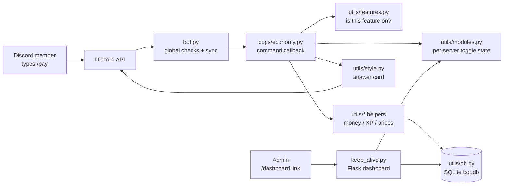

# Architecture — how Meow Bot fits together 🗺️

A tour for new contributors. Nothing here is new information — it just connects
the files so you know where to look.

## The big picture

Two processes in one: `bot.py` (Discord gateway) and `keep_alive.py` (Flask web
dashboard in a background thread). They share state through `utils/modules.py`
— the **only** reader/writer of on/off toggles — so the dashboard and the bot
can never disagree.

## What happens when someone runs a slash command

1. **Discord** routes `/pay` to the bot process.
2. **`bot.py → global_module_check`** runs first for *every* command:
   - DMs? Only `DM_ALLOWED_COMMANDS` may run outside a server.
   - Always-allowed (`help`, `dashboard`, `sync`, …)? Through.
   - Otherwise look up `MODULE_COMMAND_MAP` (built from `utils/features.py`)
     and refuse with a "turned off, re-enable in the dashboard" card if any
     required feature is off for that server.
3. **Permission checks** run (declared once in `utils/permissions.py`,
   enforced by discord.py decorators or an in-callback guard).
4. **The cog callback** (`cogs/*.py`) does the work, calling `utils/*`
   helpers. Money moves inside `db.run_atomic()` transactions so two
   simultaneous commands can't spend the same coin twice.
5. **The reply** goes out as a card via `utils/style.py` (`send_card`),
   which suppresses accidental pings by default.

## Where things live (and why)

| Question | Answer |
|---|---|
| Which features exist? | `utils/features.py` — one `Feature(...)` each; cogs, dashboard cards, help menu, defaults all derive from it |
| Is feature X on for server Y? | `utils/modules.py` — cached, thread-safe, shared with the dashboard |
| Who may run command Z? | `utils/permissions.py` — `COMMAND_ACCESS` table + picker-visibility stamping |
| Where is data stored? | `utils/db.py` — SQLite (`bot.db`), migrated on boot |
| How do commands reach Discord? | `bot.py → sync_commands()` on every boot: compare-then-upsert, never bulk-overwrite (a rejected bulk sync once wiped a guild to 1 command) |
| How does data survive redeploys? | `utils/cloud_sync.py` — restore from Supabase on boot, upload every 25s, final flush on SIGTERM |
| Where's the dashboard? | `keep_alive.py` + `templates/` — magic-link + passkey auth, module toggles, message composer, scheduler, live market pages |
| Where do scheduled messages go? | `utils/scheduled.py` (the queue, one row per message) + `keep_alive.py` (the delivery tick, started from `bot.py`) |

## The dashboard's four jobs

1. **Module toggles** (`/api/toggle`) — persist via `utils/modules.py`, then
   schedule an immediate cloud backup so a restart can't undo the click.
2. **Message composer** (`/api/send-message`) — posts as the bot, max 5
   channels, every mention re-resolved against the live guild (a browser can
   send anything, so nothing it says is trusted).
3. **Scheduled messages** (`/api/schedule-message`) — the same builder as
   "send now", stored instead of posted, and delivered from a tick on the bot's
   own loop. Claiming a due message is one conditional `UPDATE`, so a message is
   posted exactly once no matter how many things look at it at the same moment.
4. **Live market pages** (`/market/<SYMBOL>`) — public JSON + canvas chart
   fed by the same price snapshot the commands trade on.

## Conventions that keep 600+ tests green

- **Declare, don't duplicate.** Feature? → `features.py`. Audience? →
  `permissions.py`. The tests diff the registry against the real command tree
  and fail on drift.
- **Transactions for money.** Any function that moves coins uses
  `db.run_atomic()` with conditional writes (`UPDATE … WHERE balance >= …`).
- **Pure helpers where possible.** `utils/rewards.py`, `utils/levels.py`,
  `utils/meowfee.py` take plain arguments (no `discord` import) so tests can
  call them directly.
- **Cards never ping by accident.** `send_card` defaults to
  `AllowedMentions.none()`; only `/announce` opts in, deliberately.
