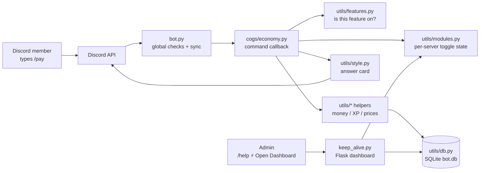

# Architecture — how Meow Bot fits together 🗺️

A tour for new contributors. Nothing here is new information — it just connects
the files so you know where to look.

## The big picture

Two processes in one: `bot.py` (Discord gateway) and `keep_alive.py` (Flask web
dashboard in a background thread). They share state through `utils/modules.py`
— the **only** reader/writer of on/off toggles — so the dashboard and the bot
can never disagree.

## What happens when someone runs a slash command

1. **Discord** routes `/pay` to the bot process.
2. **`bot.py → global_module_check`** runs first for *every* command:
   - DMs? Only `DM_ALLOWED_COMMANDS` may run outside a server.
   - Always-allowed (`help`, `dashboard`, `sync`, …)? Through.
   - Otherwise look up `MODULE_COMMAND_MAP` (built from `utils/features.py`)
     and refuse with a "turned off, re-enable in the dashboard" card if any
     required feature is off for that server.
3. **Permission checks** run (declared once in `utils/permissions.py`,
   enforced by discord.py decorators or an in-callback guard).
4. **The cog callback** (`cogs/*.py`) does the work, calling `utils/*`
   helpers. Money moves inside `db.run_atomic()` transactions so two
   simultaneous commands can't spend the same coin twice.
5. **The reply** goes out as a card via `utils/style.py` (`send_card`),
   which suppresses accidental pings by default.

## Where things live (and why)

| Question | Answer |
|---|---|
| Which features exist? | `utils/features.py` — one `Feature(...)` each; cogs, dashboard cards, help menu, defaults all derive from it |
| Is feature X on for server Y? | `utils/modules.py` — cached, thread-safe, shared with the dashboard |
| Who may run command Z? | `utils/permissions.py` — `COMMAND_ACCESS` table + picker-visibility stamping |
| Where is data stored? | `utils/db.py` — SQLite (`bot.db`), migrated on boot |
| How do commands reach Discord? | `bot.py → sync_commands()` on every boot: compare-then-upsert, never bulk-overwrite (a rejected bulk sync once wiped a guild to 1 command) |
| How does data survive redeploys? | `utils/cloud_sync.py` — restore from Supabase on boot, upload every 25s, final flush on SIGTERM |
| Where's the dashboard? | `keep_alive.py` + `templates/` — magic-link + passkey auth, module toggles, message composer, scheduler, live market pages |
| Where do dashboard messages go? | `utils/scheduled.py` — one row per message, whether it is still queued or was posted the moment it was written (`source`) — plus `keep_alive.py` (the delivery tick, started from `bot.py`) |
| How does an update get shipped? | `/bot push` (`cogs/bot_config.py`) — with a Render Deploy Hook in `RENDER_DEPLOY_HOOK_URL`, `utils/deploy.py` POSTs it and the boot announces the release itself; with no hook the command says no code moved and posts this version's notes through `bot.announce_release_notes_to_guild`. The bot cannot commit: it can only deploy what is already on GitHub. Its card goes to the server's `test` channel, falling back to `update` |
| Where does the bot post in *this* server? | `utils/bot_channels.py` — `update` / `error` / `bug` / `commands` / `log` / `test` are per-guild settings, bound by channel *name* the first time a server is seen (`#update`, `#bot-error`, `#bug-report`, `#bot-cmd`, `#logs`, `#test-ground`) and authoritative after that — matched exactly first, then with decoration stripped, so `💬・bot-cmd` binds the same role. The release note's ping resolves the same way: the role id the bot has always pinged where that server has it, otherwise a role named `Dev` / `Admin` / …, otherwise nothing. A hardcoded channel id here is a bug: it names exactly one server, which is why the update channel, the failure channel, level-up cards and bug reports were all invisible everywhere else. A **bug report** is the one message allowed to leave the server it was filed in: it is posted in that server's own bug channel, and in the bot's own server (`BOT_SERVER_GUILD_ID`, whose `#bug` is found by name even before anything has been bound) when this server has none — so a report can never be refused for want of a channel, and it is never a ticket, which is the ticket panel's job for members' own problems. Two roles, `guilds` and `cmdlog`, belong to **the bot's own server only** (`roles_for` refuses them everywhere else, so no member server can bind them even by naming a channel to match): `#active-servers` and `#real-time-cmd-data` are the operator's log of who has the bot and what people run with it — see the row below |
| What does the operator learn about the bot itself? | `utils/operator_log.py`, fed by four events in `bot.py`: `on_guild_join` (a server added the bot — logged with its size, owner and, when View Audit Log allows, who added it; the same handler also binds its channels and sends it the release note, each step isolated so one failure cannot hide the others), `on_guild_remove` (removed, deleted, or banned — all one event), `on_app_command_completion` (every command, with the runner, the server, the channel and the moment), and `tree.on_error` (`command_failed` — the command, the runner, where it ran and the reason, which is the entry the operator needs most and the one completion can never produce, because discord.py dispatches completion only in the `else` branch of its own call: a command that raised never reaches it, so a broken bot used to leave an empty channel that read as "nobody uses this"). Three rules, each a failure this project already had: an entry may never break the thing it logs (every failure is reported on the host and swallowed), an entry may never ping (a card carries `NO_PINGS`, which matters because a server's *name* is a stranger's text and `@everyone` is a legal server name), and what a person **typed** is never copied into the log — the command, its runner and its outcome are the record, not its arguments. `bot_server_guild_id()` falling back on a malformed `BOT_SERVER_GUILD_ID` is what keeps a typo in an environment variable from costing the entry. A failure's *reason* is carried only when it comes from Discord (a transport fact); a Python-level error is recorded by its type alone, because a message raised while handling what somebody typed can quote it back and the log promises never to copy that. `report_second_instance` is the fourth rule's opposite number: a boot that finds another live copy of the bot — the same database lease that stops two copies fighting over the backup, `cloud_sync.other_live_owner`, read for the gateway hazard — posts one card naming it, because two sessions of one application receive every interaction, one answers, and the loser's command ends in *Interaction has already been acknowledged* while the ones that reach a quiet session are answered too late to count. `announce_setup` posts the one-time card that explains both channels, on the boot that binds them and never again (it is posted from what that boot *wrote*, not from a read-back of the store, so a write that has not landed cannot cost the card that exists to explain the channel), and `_notice_missing` reports the first entry that finds nothing bound — into the update, then error, then log channel, once per role per process, because an installed feature that writes nowhere is otherwise indistinguishable from one that works |
| Why is a command missing from the picker — or still in it after being removed? | `utils/commands_sync.py` compares, `bot.py` publishes, `force_sync.py` does the same job from a terminal. Three rules, each already paid for: **read → compare → write**, because Discord allows 200 command writes a day per scope and a blind re-upload spends them on nothing; **upsert one command at a time, never a bulk overwrite**, because a rejected bulk sync has already deleted the scope's whole list (this bot was once left with a single command); and **a name leaves the picker only by being on `RETIRED_COMMANDS`**, because the publisher can only add or replace — a folded command has no local counterpart, so it is neither missing nor stale and nothing else would ever remove it. That list is load-bearing: Discord allows **100 chat-input commands per scope**, and twelve folded names (`/dashboard`, `/sync`, `/updatedb`, `/setavatar`, `/setbanner`, `/addlevelrole`, `/removelevelrole`, `/privacy`, `/tos`, `/meowfee`, `/activity-top`, `/activity-channel`) held the last of that budget, so creating `/bot` and `/legal` was answered with ``30032 Maximum number of application commands reached``. A refusal of one command must not stop the ones behind it — the scope is only full for a *new* name, and updates are still allowed — but a spent daily budget must stop everything, because that window is closed for all of them. Whichever it is, the boot prints the reason: a scope that published nothing used to say only *"published 0, 32 still pending"*, which is how a picker missing two commands and offering twelve dead ones stayed that way for weeks. The `/bot push` command and every deploy go through this same path. |

## The dashboard's four jobs

1. **Module toggles** (`/api/toggle`) — persist via `utils/modules.py`, then
   schedule an immediate cloud backup so a restart can't undo the click.
2. **Message composer** (`/api/send-message`) — posts as the bot, max 5
   channels, every mention re-resolved against the live guild (a browser can
   send anything, so nothing it says is trusted).
3. **Scheduled messages** (`/api/schedule-message`) — the same builder as
   "send now", stored instead of posted, and delivered from a tick on the bot's
   own loop. Claiming a due message is one conditional `UPDATE`, so a message is
   posted exactly once no matter how many things look at it at the same moment.
   An immediate send is written to the same table as a finished row
   (`utils.scheduled.record_sent`), which is the only record it leaves: the
   receipt lives in the page, and "which channels got that announcement?" has to
   outlive it. Only `pending` rows are ever delivered, so a record can never be
   posted twice. A delivery that did **not** arrive — refused, partly refused,
   skipped for being too late, or interrupted by a restart — is posted as a card
   in the guild's `log_channel_id`, tagging whoever queued it
   (`keep_alive._alert_schedule_outcome`); with no usable log channel that person
   is DM'd instead. A message that went out is not news: it is visible in the
   channel it landed in.
4. **Live market pages** (`/market/<SYMBOL>`) — public JSON + canvas chart
   fed by the same price snapshot the commands trade on.

## Conventions that keep 600+ tests green

- **Declare, don't duplicate.** Feature? → `features.py`. Audience? →
  `permissions.py`. The tests diff the registry against the real command tree
  and fail on drift.
- **Transactions for money.** Any function that moves coins uses
  `db.run_atomic()` with conditional writes (`UPDATE … WHERE balance >= …`).
- **Pure helpers where possible.** `utils/rewards.py`, `utils/levels.py`,
  `utils/meowfee.py` take plain arguments (no `discord` import) so tests can
  call them directly.
- **Cards never ping by accident.** `send_card` defaults to
  `AllowedMentions.none()`; only `/announce` opts in, deliberately.
